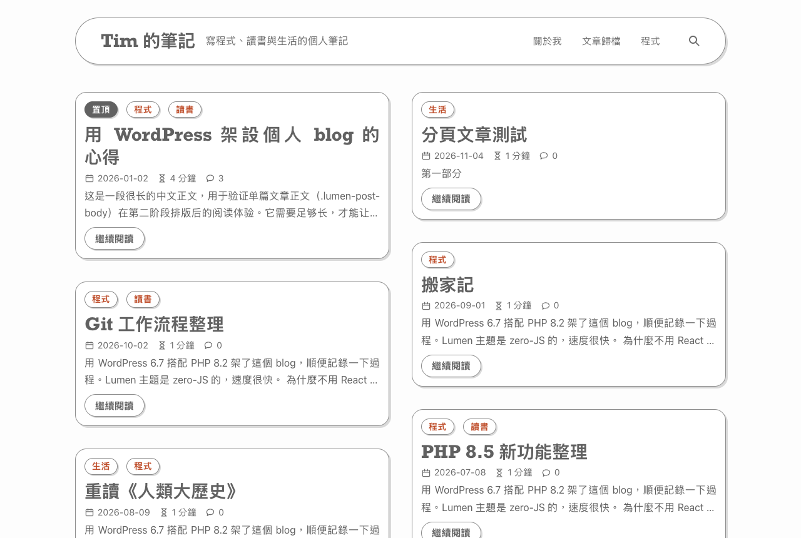
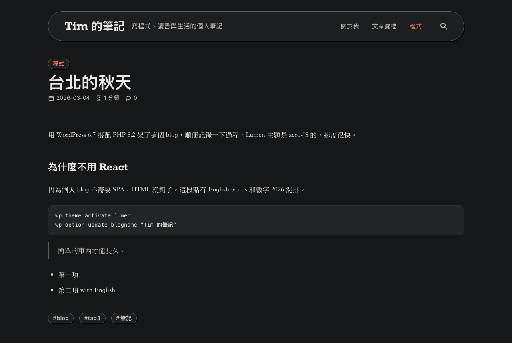
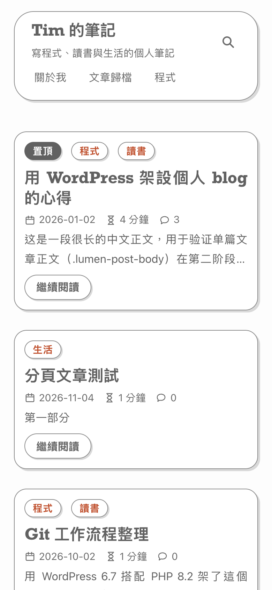

# Lumen

為中文寫作打造的 WordPress 個人部落格佈景主題。安靜、以文字為主，
**零 JavaScript、不載入網路字型**，整個佈景主題只有一個 CSS 檔。

| 首頁（淺色） | 文章頁（深色） | 手機 |
| --- | --- | --- |
|  |  |  |

**下載：** [GitHub Releases](https://github.com/wwintj/lumen/releases/latest)　·　**變更紀錄：** [CHANGELOG.md](CHANGELOG.md)

---

## 有什麼

**版面**
- 一行的膠囊頁首（網站名稱、副標題、選單、搜尋），全站內容與頁首同寬、左右對齊。
- 首頁與各彙整頁是兩欄瀑布流卡片：分類膠囊 → 標題 → 日期／閱讀時間／留言數 → 摘要 → 繼續閱讀。
- 白底描邊加淺灰平面投影的統一風格；只用一種強調色（磚紅），用在分類、滑鼠懸停與目前所在的選單項目。
- 跟隨系統的自動深色模式，不需要切換按鈕。

**閱讀**
- 正文使用仿宋閱讀字型，標題為粗體；中英混排自動留白、標點自動擠壓。
- 文章頁有閱讀時間、文末標籤、上一篇／下一篇按鈕（附標題）、`<!--nextpage-->` 分頁與特色圖片。

**找文章**
- 頁首放大鏡在圖示下方彈出小搜尋框（`Esc` 或點擊外部即關閉）。
- 分類、標籤、作者、日期頁有大標題、篇數與麵包屑（首頁 / 父分類 / 分類）。
- 「文章歸檔」頁面範本：依年份列出全部文章；首頁的置頂文章會標示「置頂」。

**留言**
- WordPress 原生巢狀留言，泡泡式版面；評論者名稱為純文字，不連到外部網站。

**其他**
- 內建繁體（`zh_TW`）與簡體（`zh_CN`）中文介面。
- 語意化 HTML、每頁一個 `<h1>`、鍵盤可操作、尊重「減少動態效果」設定；顏色對比度都符合 WCAG AA。
- 不輸出 SEO 標籤與結構化資料，交給 Rank Math、Yoast 等 SEO 外掛處理，避免重複。

## 安裝

需要 WordPress 6.3 以上（已在 7.1 測試）、PHP 8.2 以上。

1. 到 [Releases](https://github.com/wwintj/lumen/releases/latest) 下載 `lumen-x.y.z.zip`，**不要解壓縮**。
2. WordPress 後台 → **外觀 → 佈景主題 → 安裝佈景主題 → 上傳佈景主題**，選擇 ZIP。
3. 已裝過舊版時，WordPress 會詢問是否取代，選 **以上傳的版本取代目前版本**。
4. 啟用。

## 第一次設定

1. **選單**（外觀 → 選單）：建立選單並指定到 **Primary menu**（頁首）與 **Footer menu**（頁尾）。只顯示第一層。
2. **文章歸檔頁**（頁面 → 新增頁面）：標題例如「文章歸檔」，右側「範本」選 **Archives (all posts by year)**，
   發布後加入選單。頁面內文會顯示在列表上方，可以留空。
3. **網站語言**（設定 → 一般）：選繁體或簡體中文，佈景主題介面會跟著切換。
4. **每頁文章數**（設定 → 閱讀）：首頁與各彙整頁都依這個數字分頁。
5. **Logo**（外觀 → 自訂 → 網站識別）：選用。有 Logo 時會取代頁首的網站名稱。

## 從舊版升級

1.3.0 重新設計了版面，HTML 結構與 class 名稱都和舊版不同，升級前請留意：

- **額外 CSS**：如果在「外觀 → 自訂 → 額外 CSS」寫過針對舊 class 的樣式，請檢查或移除。
- **Lumen Blog 外掛**：已不再提供（它本來就沒有功能），可直接停用並刪除。
- **選單**：只顯示第一層，子選單項目不會出現。
- **首頁篇數**：遵循「設定 → 閱讀」，建議設為雙數（例如 10），瀑布流的兩欄會比較平均。

文章、分類、標籤、留言等內容都不受影響。

## 寫作小提示

- **摘要**：清單會自動擷取文章開頭（中文約 90 字）。想自訂時，在編輯器右側填寫「摘要」。
- **置頂**：在文章設定勾選「置頂」，該文章會排在首頁第一頁最前面。
- **分頁長文**：在內文插入「分頁」區塊（或 `<!--nextpage-->`），文末會出現頁碼。
- **編輯器顏色**：調色盤裡的顏色在深色模式下會自動換成對應的深色版本。

## 開發

```
lumen/
  style.css                    佈景主題標頭
  assets/css/main.css          全部樣式：變數（淺／深）→ 版面 → 元件
  functions.php                載入 inc/
  inc/setup.php                theme supports、選單、資源
  inc/template-tags.php        膠囊、閱讀時間、摘要、分頁等輸出函式
  inc/comments.php             留言表單與列表調整
  index.php                    首頁與所有彙整頁
  single.php · page.php · search.php · 404.php · comments.php
  page-templates/archives.php  文章歸檔範本
  template-parts/              文章清單、清單項目、彙整標題面板
  languages/                   lumen.pot、zh_TW、zh_CN
docs/                          README 用截圖
```

- **顏色**都定義在 `main.css` 開頭的 `:root`，深色值在緊接著的 `@media (prefers-color-scheme: dark)`。新元件請使用這些變數，深色模式就會自動正確。強調色 `--accent` 只用在分類、懸停與目前選單項目。
- **間距**統一由 `--space`（14px）控制：卡片內各部件的間距與卡片內邊距都是它。
- **翻譯**：修改字串後重新產生 POT，編輯 `zh_TW.po`／`zh_CN.po`，再編譯 MO：

  ```bash
  wp i18n make-pot lumen lumen/languages/lumen.pot --domain=lumen --exclude=languages
  ```

  ```bash
  wp i18n make-mo lumen/languages
  ```

- **發布**：版本號在 `lumen/style.css`、`lumen/functions.php`（`LUMEN_VERSION`）、`lumen/readme.txt`。
  正式版會建立 tag 與 GitHub Release，附上只含 `lumen/` 資料夾的 ZIP 與 SHA256 校驗檔。

## 授權

GPL-2.0-or-later，見 [LICENSE](LICENSE) 與 [NOTICE.md](NOTICE.md)。

使用中的網站：[zhec.org](https://zhec.org)
